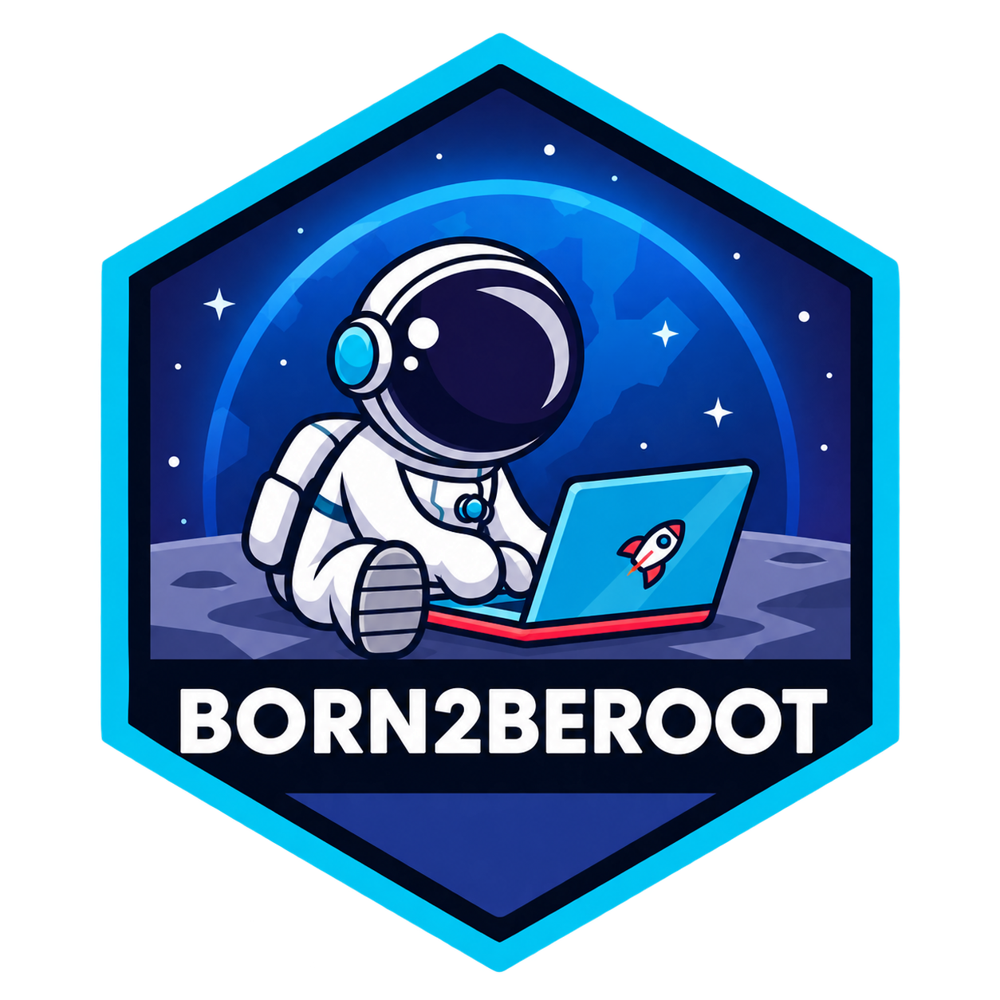
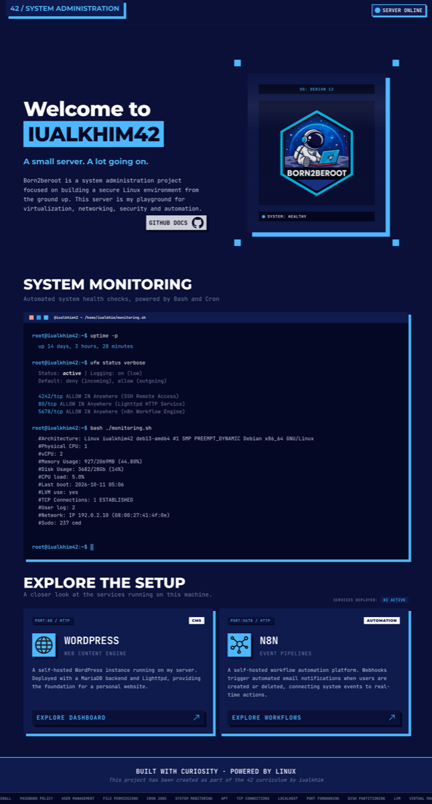

*This project has been created as part of the 42 curriculum by iualkhim*

<p align="center">
  
</p>

## Description

The main goal of the **Born2beroot** project
is to create and configure a **Linux** environment inside a virtual machine.

The system is built from scratch to explore the fundamentals of **system administration**, **security** and **server management**.

The main topics covered are ***users and groups, permissions, `sudo`, SSH, password policies, disk partitioning, encrypted volumes, LVM, firewall configuration and system monitoring***.

The bonus part includes the following additional services:

- **WordPress** — Lighttpd, PHP and MariaDB.
- **Docker** — containerization.
- **n8n** — self-hosted workflow automation.

### Project Description

#### *Virtualization: VirtualBox vs UTM*

| | VirtualBox | UTM |
|---|---|---|
| **Strengths** | - Multiplatform (Windows, Linux, macOS Intel)<br> - Well-established, with extensive documentation and community support <br> - More networking modes<br> - Snapshots<br> - Great on Intel/AMD | - Apple's native virtualization<br> - Built for Apple Silicon (fast ARM guests)<br> - Lightweight |
| **Weaknesses** | - Limited performance on Apple Silicon (M1–M4)<br> - Heavier on resources | - macOS only<br> - Lacks some advanced features |

#### -> *Selected: VirtualBox*

- standard tool at 42.
- runs well on my Intel/AMD machine.
- plenty of documentation that helped me with the configuration.

#### *System: Debian vs Rocky Linux*

| | **Debian** | **Rocky Linux** |
|---|---|---|
|***Philosophy*** | Community-driven, independent | Enterprise-oriented |
| ***Docs & community*** | Extensive documentation, large community | Smaller community, fewer guides |
| ***Learning curve*** | Beginner-friendly | Steeper |
| ***Packages*** | Huge repository (`apt`) | Fewer packages in default repos |
| ***Security (MAC)*** | **AppArmor**:<br> + enabled by default<br> + simple, human-readable profiles<br> + easy to learn and maintain<br> - confines individual applications only | **SELinux**:<br> + enabled by default<br> + controls the whole system (users, files, processes, ports)<br> + very fine-grained control<br> - complex configuration<br> - harder to debug |
| ***Firewall*** | **UFW**:<br> + simple syntax<br> + ideal for a single server with few rules<br> - not installed by default<br> - less flexible | **firewalld**:<br> + default in Rocky Linux<br> + zones: different rules per network<br> - more complex |

#### -> *Selected: Debian (with AppArmor and UFW)*

- beginner-friendly and has extensive documentation.
- its huge package repository covers the bonus services (WordPress, Docker, n8n).
- AppArmor and UFW come with Debian's ecosystem and are simple enough to configure for a single server.

## Instructions

1. Clone the project and enter the folder:
```bash
   git clone https://github.com/JuliAlchemDev/42_born2beroot.git born2beroot
  cd born2beroot
```
2. Set up the virtual machine and install Debian: see [System Installation](./docs/system_install.md).
3. Configure the system (users, sudo, SSH, firewall...): see [System Configuration](./docs/system_config.md).
4. Once the system is ready and port forwarding is configured, get the IP address of the host machine (macOS) with `ipconfig getifaddr en0` and save it in a `config.local` file:
```bash
   SERVER_IP=192.0.2.11
```
5. Use the [connect_to script](./connect_to.sh) to connect to the VM or open its services:
```bash
   ./connect_to.sh [born2beroot|wordpress|n8n]
```
6. Set up the monitoring script: copy [monitoring.sh](./monitoring.sh) to the VM via SSH (`scp`) or configure it manually, following [Monitoring](./docs/monitoring.md).
7. Install WordPress (Lighttpd, PHP and MariaDB): see [WordPress](./docs/wordpress.md).
   - The Lighttpd section covers the default page and the custom 404 setup, so you can serve my [landing page sample](./landing-page/) -> [live demo](https://julialchemdev.github.io/42_born2beroot/).

   | **Landing** | **404** |
   |---|---|
   |  |  |
8. Install Docker and n8n: see [n8n](./docs/n8n.md).
9. Defence preparation:
   - Once the installation and configuration are finished, shut the VM down and generate its signature:
```bash
     cd "$HOME/VirtualBox VMs/born2beroot"

     # The SHA-1 signature shows the VM has not been modified since it was submitted
     shasum born2beroot.vdi | cut -d ' ' -f 1 > signature.txt
```

## Resources

### Project Documentation

Notes on the system configuration, the purpose of each component and the concepts behind them.

| Documentation | Description |
| ----- | ------|
|[System Installation](./docs/system_install.md)| - virtual machine setup and Debian installation |
|[System Configuration](./docs/system_config.md)| - users, groups, sudo, SSH, password policy and firewall |
|[Monitoring](./docs/monitoring.md)| - system [monitoring script](./monitoring.sh)  and cron configuration |
|[WordPress](./docs/wordpress.md)| - WordPress setup with Lighttpd, PHP and MariaDB |
|[n8n](./docs/n8n.md)| - Docker and n8n setup and configuration |

### Scripts and files

Scripts used during the project, plus a sample landing page for the web server.

| File | Description |
| ----- | ------|
| [monitoring.sh](./monitoring.sh) | - reports system information (architecture, CPU, RAM, disk, load, last boot, LVM, connections, users, network, sudo commands) |
| [monitoring.sh](./monitoring.sh) | - reports system information: architecture, CPU, memory, disk, load, last boot, LVM, connections, users, network and sudo commands |
| [landing-page](./landing-page/) | - sample web page (`index.html`, `404.html`, styles and images) served by Lighttpd |


---
**AI Usage:** I used several AI tools as support throughout the project, always as a learning aid: all the configuration was done and understood by me.

| **ChatGPT** | **Claude** | **Stitch** |
| ----- | ------| ------|
| - discuss concepts and experiment with system configurations <br> - document the processes <br> - generate practice questions to check my understanding | - discuss concepts and documentation once more, as a second opinion, to check my understanding <br> - structure this README and its comparison tables <br> - speed up the styles and animations of the landing page | - define the design system <br> - prototype the landing page <br> - prototype the 404 page |
